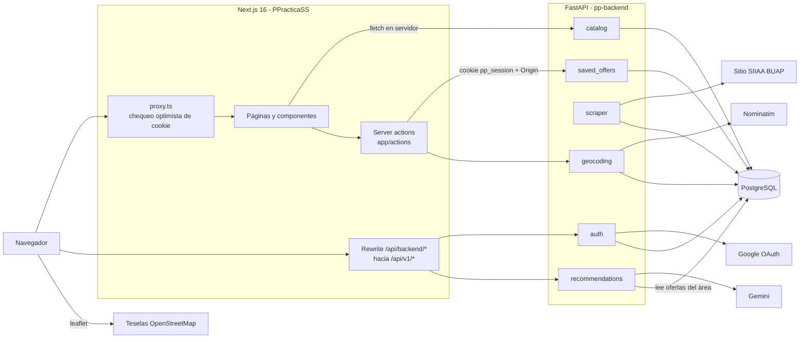
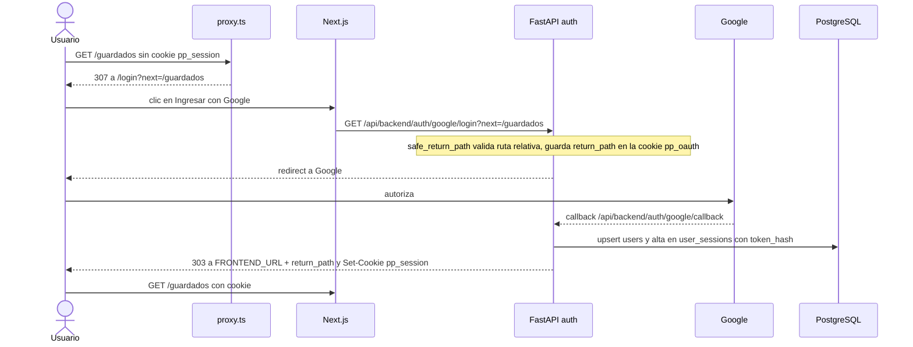
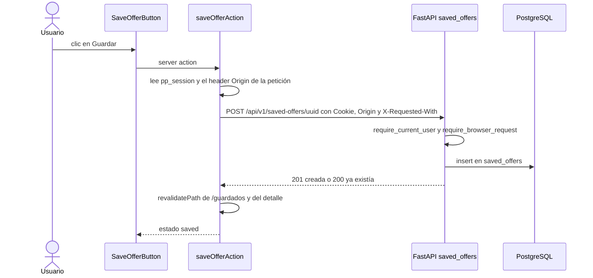
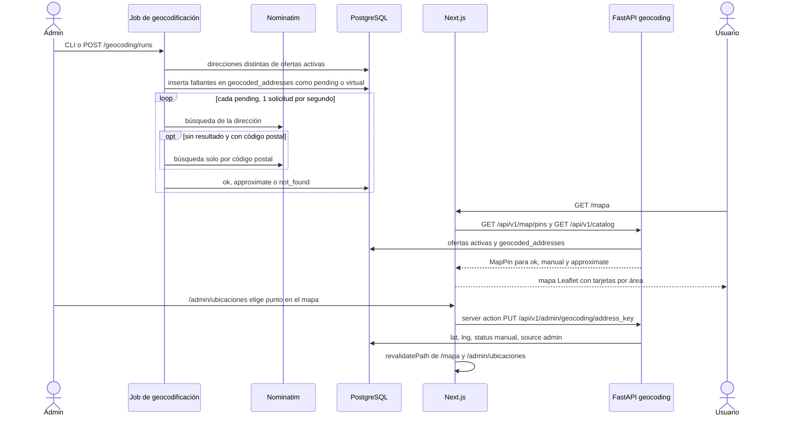

# Arquitectura

**PPracticaSS** es una aplicación web para explorar ofertas de servicio social y prácticas profesionales de la BUAP por área de estudio. Un backend FastAPI (`pp-backend`) extrae el catálogo del sitio SIIAA, lo guarda en PostgreSQL y lo sirve como API; un frontend Next.js 16 lo presenta (catálogo, detalle, mapa con ubicaciones reales, ofertas guardadas, recomendaciones a partir del CV con Gemini) y permite iniciar sesión con Google. Un rol `admin` corrige ubicaciones del mapa.

- Frontend: este repositorio (`PPracticaSS`), Next.js 16 + React 19 + Tailwind v4.
- Backend: `pp-backend`, monolito modular FastAPI + SQLModel + Alembic. Ver su [README](https://github.com/AlanValerdi/pp-backend) y su `docs/ARCHITECTURE.md` (parcialmente desactualizado, ver [STAGES.md](STAGES.md)).

## Vista general

## Módulos del backend

Prefijo de la API: `/api/v1` (más `GET /health` en la raíz). El JSON usa camelCase.

| Módulo | Responsabilidad | Endpoints principales | Archivos clave (`app/modules/...`) |
| --- | --- | --- | --- |
| `catalog` | Lee el catálogo desde PostgreSQL | `GET /catalog`, `GET /areas/{slug}`, `GET /offers/{offer_uuid}`, `GET /health` | `catalog/router.py`, `repository.py`, `schemas.py`, `models.py` |
| `scraper` | Descarga el SIIAA con HTTP, normaliza y hace upsert idempotente | `POST /scrape/runs` (202), `GET /scrape/runs/{run_id}`, `POST /scrape/preview` (todos con `X-Admin-Key`); CLI `python -m app.modules.scraper.cli run` | `scraper/service.py`, `client.py`, `parsers/`, `normalize.py`, `classification.py`, `jobs.py`, `cli.py` |
| `auth` | Login con Google, sesiones propias, logout | `GET /auth/google/login?next=`, `GET /auth/google/callback`, `GET /auth/me`, `POST /auth/logout` | `auth/router.py`, `service.py`, `oauth.py`, `models.py` |
| `saved_offers` | Ofertas guardadas por usuario | `GET /saved-offers`, `POST /saved-offers/{offer_uuid}`, `DELETE /saved-offers/{offer_uuid}` | `saved_offers/router.py`, `service.py`, `repository.py` |
| `recommendations` | Analiza un CV en PDF y sugiere hasta 3 ofertas de un área | `POST /recommendations/analyze` (multipart `cv` + `areaSlug`) | `recommendations/service.py`, `app/integrations/gemini.py` |
| `geocoding` | Geocodifica direcciones con caché, sirve pines y correcciones de admin | `GET /map/pins` (público), `GET /admin/geocoding?status=`, `PUT /admin/geocoding/{address_key}`, `POST /geocoding/runs?retryNotFound=`; CLI `python -m app.modules.geocoding.cli run` | `geocoding/service.py`, `client.py`, `normalize.py`, `repository.py` |
| `core` y `api` | Configuración, engine async, guards (`X-Admin-Key`, CSRF, usuario actual, admin) | n/a | `app/core/config.py`, `security.py`, `db.py`, `app/api/deps.py` |

## Áreas del frontend

| Área | Rutas / archivos | Qué hace |
| --- | --- | --- |
| Catálogo | `/` (`app/(core)/page.tsx`), `/facultad/[areaId]`, `/facultad/[areaId]/[ofertaId]` | Carrusel de áreas por sección, tabla de ofertas, detalle de oferta |
| Guardados | `/guardados`, `app/actions/saved-offers.ts`, `components/save-offer-button.tsx` | Lista, guarda y quita ofertas |
| Mapa | `/mapa`, `components/map.tsx`, `offers-map.tsx`, `lib/map-pins.ts`, `lib/api/map.ts` | Pines reales con tarjetas por área (Leaflet) |
| Administración | `/admin/ubicaciones`, `components/locations-manager.tsx`, `location-picker.tsx`, `app/actions/admin-geocoding.ts` | Corrige ubicaciones `not_found`, `approximate` y `manual` |
| Recomendaciones | `/analisis-cv`, `components/cv-recommendations.tsx`, `lib/api/recommendations.ts` | Sube un PDF y muestra resumen y ofertas sugeridas |
| Autenticación | `/login`, `proxy.ts`, `lib/auth-routes.ts`, `lib/api/auth.ts`, `hooks/use-auth.ts`, `components/app-sidebar.tsx` | Login con Google, protección de rutas, usuario en la barra lateral |
| Otros | `/dashboard` (solo estructura visual), `/registro` (plantilla sin enlazar a la app) | Ver [STAGES.md](STAGES.md) |

Helpers de `lib/`:

| Archivo | Uso |
| --- | --- |
| `lib/api/*.ts` | Consultas al backend desde el servidor (`catalog`, `dataTable`, `offer`, `saved-offers`, `map`, `admin-geocoding`, `auth`) y la llamada del navegador a `recommendations` |
| `lib/api-types.d.ts` | Tipos generados desde OpenAPI (ver [MODELS.md](MODELS.md)) |
| `lib/auth-routes.ts` | `SESSION_COOKIE`, rutas protegidas, `safeReturnPath`, `getGoogleLoginHref`, `getLoginPagePath` |
| `lib/navigation.ts`, `lib/nav-visibility.ts` | Menú lateral y visibilidad por rol |
| `lib/map-pins.ts` | `getPinHref`, `parseCoordinates`, `buildAreaLookup`, `describeOfferAreas` |
| `lib/catalog-search.ts` | Índice y búsqueda del campo de búsqueda global |

## Flujos clave

### 1. Login con Google y ruta de retorno (`next`)

Si el login falla, el backend redirige a `/?authError=google_login_failed`. El botón de la barra lateral usa `usePathname()` como `next`.

### 2. Guardar una oferta

La acción también envía `?areaSlug=` al backend; la versión actual del backend no define ese parámetro (ver desajuste en [MODELS.md](MODELS.md)).

### 3. Mapa: geocodificación, pines y corrección de admin

## Decisiones transversales

| Tema | Decisión | Dónde verlo |
| --- | --- | --- |
| Sesión | Cookie `pp_session` (httpOnly, `SameSite=Lax`). El backend guarda solo el hash SHA-256 del token en `user_sessions`. Duración por defecto: `SESSION_TTL_SECONDS=600` (10 minutos), configurable | `auth/service.py`, `auth/router.py`, `core/config.py` |
| Roles | `users.role` es `user` o `admin`. `require_admin_user` responde 403 si no es admin. El rol se asigna fuera de la app (no hay UI para promover admins) | `api/deps.py`, `odd/tasks/map-geocoding.md` |
| Llave de scripts | `X-Admin-Key` (variable `ADMIN_API_KEY`) protege solo `/scrape/*`. No se mezcla con la sesión de usuarios | `core/security.py` |
| CSRF | Escrituras del navegador exigen `Origin` igual a `FRONTEND_URL` y `X-Requested-With: XMLHttpRequest` (`require_browser_request`). Aplica a logout, guardar/quitar oferta, analizar CV, `PUT /admin/geocoding/...` y `POST /geocoding/runs`. Las server actions reenvían ambos headers | `core/security.py`, `app/actions/*.ts` |
| Protección de rutas | `proxy.ts` solo comprueba que exista la cookie (chequeo optimista) para `/guardados`, `/analisis-cv` y `/admin`. La validación real la hacen `requireSession()` y `requireAdmin()` (consultan `/auth/me`) y el backend | `proxy.ts`, `lib/api/auth.ts` |
| Retorno tras login | La ruta `next` se valida dos veces (`safeReturnPath` en el frontend y `safe_return_path` en el backend): solo rutas relativas, sin `//`, `/\` ni caracteres de control, máximo 512 caracteres | `lib/auth-routes.ts`, `auth/router.py` |
| Conexión al backend | El navegador llama a `/api/backend/*` (rewrite hacia `API_BASE_URL/api/v1/*`) para que la cookie sea del mismo sitio. Las páginas del servidor llaman directo a `API_BASE_URL` | `next.config.ts` |
| Next 16 y Suspense | `cacheComponents: true`. Lo que lee datos de la petición (`usePathname`, `searchParams`, `cookies()`, `fetch` sin caché) debe quedar dentro de `<Suspense>` (o bajo un `loading.tsx`) para que la ruta siga siendo prerenderable | `app/login/page.tsx`, `components/app-sidebar.tsx`, `app/(core)/mapa/page.tsx` |
| Tailwind v4 y Leaflet | Las utilidades de Tailwind viven en una capa y `leaflet.css` no tiene capa, así que gana. Para sobrescribir estilos de Leaflet usa `!` (por ejemplo `m-0!`) | `components/offers-map.tsx` |
| Geocodificación | Nominatim público: máximo 1 solicitud por segundo y User-Agent identificable. Todo se cachea en `geocoded_addresses`. Una fila `manual` nunca se sobrescribe. El respaldo por código postal se consulta **solo** con `postalcode` (agregar estado o país hace que Nominatim no devuelva nada) | `geocoding/client.py`, `service.py` |
| Contrato de tipos | `lib/api-types.d.ts` se genera desde OpenAPI y no se edita a mano (ver [MODELS.md](MODELS.md)) | README de `pp-backend` |
| Datos sensibles de Gemini | La clave solo vive en el `.env` del backend. A Gemini se envía el PDF y datos profesionales de las ofertas, sin contactos de supervisores | `integrations/gemini.py`, README de `pp-backend` |
| Despliegue del scraper | Un solo worker y una instancia: el lock del scrape vive en memoria | `scraper/jobs.py` |

## Ejecución local (ruta rápida)

1. Backend: en `pp-backend`, copia `.env.example` a `.env`, define `OAUTH_SESSION_SECRET` y ejecuta `docker compose up -d --build`. La API queda en `http://localhost:8001` (`/health`, `/docs`) y el contenedor aplica las migraciones.
2. Frontend: en `PPracticaSS`, crea `.env.local` con `API_BASE_URL=http://localhost:8001`, luego `pnpm install` y `pnpm dev` (`http://localhost:3000`). Sin `API_BASE_URL`, `next.config.ts` lanza un error al arrancar.
3. Google (opcional): `GOOGLE_CLIENT_ID` y `GOOGLE_CLIENT_SECRET` en el `.env` del backend y la URI de redirección `http://localhost:3000/api/backend/auth/google/callback`.
4. Catálogo y mapa: una base nueva está vacía. Carga con el scraper y luego geocodifica con `uv run python -m app.modules.geocoding.cli run`.

Detalle completo: [README del frontend](../README.md) y [README del backend](https://github.com/AlanValerdi/pp-backend#readme).

Comprobaciones: `pnpm lint`, `pnpm exec tsc --noEmit --incremental false` y `node --test tests/*.test.mjs` (frontend, sin script en `package.json`); `uv run pytest`, `uv run ruff check .` y `uv run mypy app` (backend).
