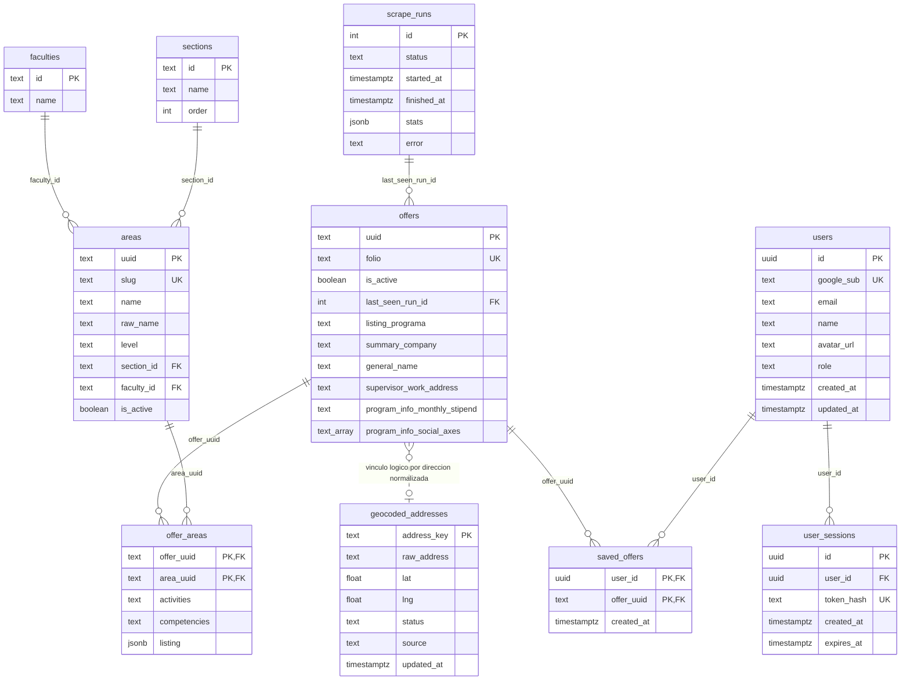
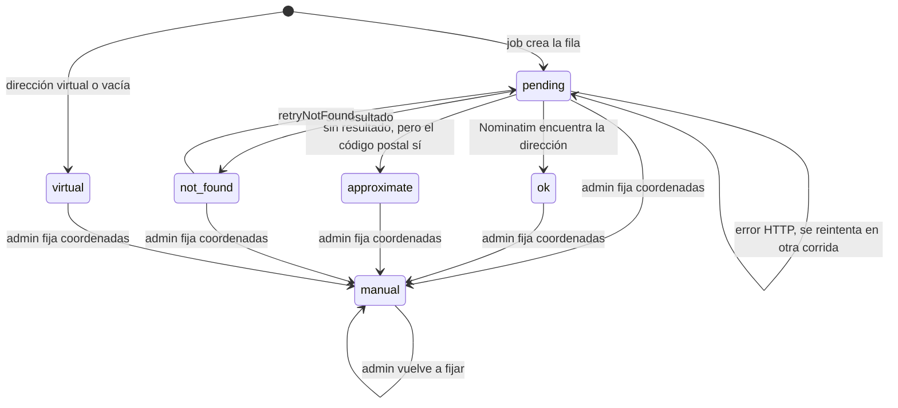
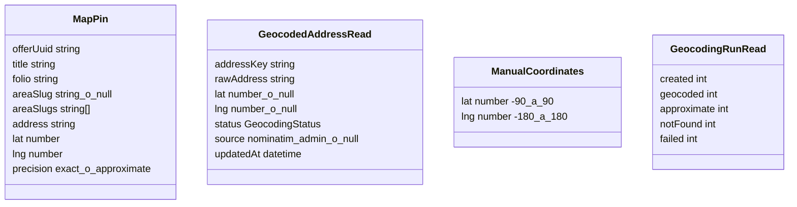

# Modelos de datos

Resumen: PostgreSQL 17 con **10 tablas** definidas con SQLModel en `pp-backend/app/modules/*/models.py` y creadas por 6 migraciones de Alembic. El catálogo (`sections`, `faculties`, `areas`, `offers`, `offer_areas`) y `scrape_runs` provienen del scraper; `users`, `user_sessions` y `saved_offers` de la autenticación; `geocoded_addresses` del mapa.

## Diagrama entidad-relación

Notas de lectura:

- `offers` tiene muchas más columnas. Las demás se agrupan por prefijo: `listing_*` (programa, tipo, área, perfil educativo, coordinador, curso de inducción, empresa), `summary_*` (tipo, número de programa, fechas de registro, empresa, sector, periodo, revalidado, estatus), `general_*` (nombre, tipo de programa, departamento, fechas de inicio y fin, duración en meses), `supervisor_*` (nombre, cargo, correo, teléfono, direcciones de entrevista y de trabajo), `appointment_*` (destinatario y cargo para la carta) y `program_info_*` (apoyo mensual, otros apoyos, ejes sociales, emprendimiento). Fuente: `app/modules/catalog/models.py`.
- `offers` y `areas` usan UUID v5 como `text` (deterministas: el mismo folio produce el mismo `uuid` en cada scrape). `users.id` y `user_sessions.id` son UUID v4 nativos.
- **Vínculo lógico, no FK:** `geocoded_addresses.address_key` es `normalize_address(offers.supervisor_work_address)` (minúsculas, sin acentos, espacios y comas normalizados). El backend la une en código (`geocoding/service.py`), no con una clave foránea.
- `ON DELETE CASCADE`: `offer_areas` (ambos lados), `saved_offers` (ambos lados) y `user_sessions.user_id`. `offers.last_seen_run_id` no tiene `ON DELETE`.
- Cadena de migraciones: `0001_create_catalog` → `0002_area_listing` → `c2d6060c3817` (users y sesiones) → `d2ced4865fd9` (saved_offers) → `e7a1c3b94d20` (geocoded_addresses y `users.role`) → `f3b8d2a6c715` (estado `approximate`).

## Tablas

| Tabla | Propósito | Columnas clave | Restricciones y enums |
| --- | --- | --- | --- |
| `sections` | Grupos del catálogo (Ingenierías, Licenciaturas, Área de la salud, Economía y administración) | `id`, `name`, `order` | `id` es el slug, por ejemplo `economia` |
| `faculties` | Facultades reconocidas en el detalle de las ofertas | `id` (corto, por ejemplo `fcc`), `name` | n/a |
| `areas` | Una carrera | `uuid`, `slug`, `name`, `raw_name`, `level`, `section_id`, `faculty_id`, `is_active` | `slug` único; `level` es `Lic` o `Ing` en la API (`ProgramLevel`) |
| `offers` | Un programa, identificado por folio | `uuid`, `folio`, `is_active`, `last_seen_run_id`, bloques `listing_*` a `program_info_*` | `folio` único; `program_info_social_axes` es `text[]`; solo las activas salen en el catálogo |
| `offer_areas` | Relación muchos a muchos oferta-carrera, con el texto propio de cada carrera | `offer_uuid`, `area_uuid`, `activities`, `competencies`, `listing` (JSONB) | PK compuesta; de aquí salen `areaDetails` y `offerIds` |
| `scrape_runs` | Historial de ejecuciones del scraper | `id`, `status`, `started_at`, `finished_at`, `stats`, `error` | `status` observado en el código y la documentación: `running`, `succeeded`, `failed` (columna de texto sin `CHECK`) |
| `users` | Usuarios que entraron con Google | `id`, `google_sub`, `email`, `name`, `avatar_url`, `role` | `google_sub` único; `role` con `CHECK` `user` o `admin` (por defecto `user`) |
| `user_sessions` | Sesiones de la aplicación (cookie `pp_session`) | `id`, `user_id`, `token_hash`, `expires_at` | `token_hash` único (SHA-256, nunca el token); índice en `user_id` |
| `saved_offers` | Ofertas guardadas | `user_id`, `offer_uuid`, `created_at` | PK compuesta; una oferta por usuario |
| `geocoded_addresses` | Caché de geocodificación por dirección distinta | `address_key`, `raw_address`, `lat`, `lng`, `status`, `source`, `updated_at` | `status` con `CHECK` en `pending`, `ok`, `approximate`, `not_found`, `manual`, `virtual`; `source` es `NULL`, `nominatim` o `admin` |

## Estados de `geocoded_addresses.status`

- El job (`run_geocoding`) solo procesa filas `pending`; `save_result` ignora cualquier fila que ya no esté pendiente, así que **nunca pisa un `manual`**. Solo `retryNotFound` devuelve filas `not_found` a `pending`.
- `ok`, `approximate` y `virtual` no se vuelven a consultar; la única salida es la corrección manual.
- `GET /map/pins` publica filas `ok`, `manual` y `approximate` con coordenadas. `precision` es `approximate` solo para `approximate`; el resto es `exact`. `not_found`, `pending` y `virtual` no generan pin.
- La corrección manual (`PUT /admin/geocoding/{address_key}`) no valida el estado previo: funciona desde cualquiera. Establece `status=manual` y `source=admin`.

## Contrato de la API que consume el frontend

Los esquemas Pydantic (`APIModel` con `alias_generator=to_camel`) definen el OpenAPI. El frontend usa `components["schemas"][...]` de `lib/api-types.d.ts`, **generado** con `openapi-typescript` (procedimiento en el README de `pp-backend`; no se edita a mano).

### Catálogo

| Esquema | Campos | Endpoint |
| --- | --- | --- |
| `Catalog` | `meta` (`source`, `scrapedAt`, `schemaVersion`), `sections[]`, `faculties[]`, `areas[]`, `offers[]` | `GET /catalog` |
| `Section` / `Faculty` | `id`, `name` (+ `order` en `Section`) | dentro de `Catalog` |
| `Area` | `uuid`, `slug`, `name`, `rawName`, `level`, `sectionId`, `facultyId`, `offerIds[]` | `Catalog.areas` |
| `AreaPage` | `area`, `offers[]` (completas) | `GET /areas/{slug}` |
| `Offer` | `uuid`, `listing`, `summary`, `general`, `supervisor`, `appointment`, `programInfo`, `areaDetails[]` | `GET /offers/{offer_uuid}` |
| `OfferAreaDetail` | `areaUuid`, `activities`, `competencies`, `listing?` | dentro de `Offer` |

`listing` incluye `folio`, `programa`, `tipo` (`servicio_social` o `practica_profesional`), `area`, `perfilEducativo`, `coordinador`, `cursoInduccion`, `empresa`. Los demás bloques de `Offer` replican las columnas `summary_*`, `general_*`, `supervisor_*`, `appointment_*` y `program_info_*` en camelCase.

### Usuario, guardados y recomendaciones

| Esquema | Campos | Endpoint |
| --- | --- | --- |
| `UserRead` | `id`, `email`, `name`, `avatarUrl`, `role` (`user` o `admin`) | `GET /auth/me` |
| `SavedOfferRead` | `offerUuid`, `createdAt` | `POST /saved-offers/{offer_uuid}` |
| `SavedOfferListItem` | `SavedOfferRead` + `title`, `folio`, `remuneration`, `isActive`, `areaSlug` (o `null`), `supervisorEmail`, `workAddress` | `GET /saved-offers` |
| `RecommendationAnalysis` | `profile` (`education`, `experience`, `skills`, `tools`, `languages`, `interests`, cada uno opcional) o `null`, `recommendations[]`, `message?` | `POST /recommendations/analyze` |
| `RecommendedOffer` | `offerUuid`, `areaSlug`, `title`, `folio`, `remuneration`, `reason`, `supervisorEmail`, `workAddress` | dentro de `RecommendationAnalysis` |

### Mapa y geocodificación

- `MapPin.areaSlug` es la primera área (para el enlace al detalle) y `areaSlugs` lista **todas** las áreas a las que está abierta la oferta; el frontend pinta una tarjeta neutra si hay varias (`describeOfferAreas`).
- `GeocodedAddressRead` se obtiene con `GET /admin/geocoding?status=`; `ManualCoordinates` es el cuerpo de `PUT /admin/geocoding/{address_key}`; `GeocodingRunRead` es la respuesta de `POST /geocoding/runs`.

### Desajuste conocido: `areaSelected`

`SavedOfferListItem.areaSelected` y el parámetro `areaSlug` de `POST /saved-offers/{offer_uuid}` existen en `lib/api-types.d.ts` y en el frontend (`components/offer-save-control.tsx`, `app/actions/saved-offers.ts`), pero **no existen en el backend actual** (`saved_offers/schemas.py` y `router.py` no los definen). Según `odd/tasks/map-geocoding.md`, se reañadieron a mano porque el backend en ejecución no los tenía. Consecuencia: al regenerar los tipos desde el OpenAPI del backend se perderán, y `areaSelected` siempre llegará `undefined` (el código lo trata como `false`). Pendiente: implementarlos en el backend o quitarlos del frontend (ver [STAGES.md](STAGES.md)).
