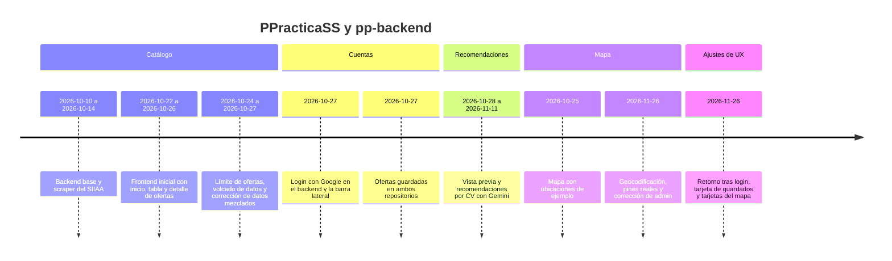

# Etapas del proyecto

**Etapa actual:** el mapa con geocodificación real y corrección de administrador quedó integrado y verificado en `main` de ambos repositorios (2026-11-26); lo siguiente es completar el scrape del catálogo y sustituir las áreas que aún son estructura visual (`/dashboard`).

Reconstruido desde `git log` de `PPracticaSS` y `pp-backend`.

## Línea de tiempo

## Tabla de etapas

| Etapa | Objetivo | Estado | Evidencia |
| --- | --- | --- | --- |
| 1. Scraper y catálogo | Bajar el catálogo del SIIAA a PostgreSQL y servirlo por API | Completada, con la salvedad del scrape completo (ver pendientes) | pp-backend: `e5e94d8`, `83b9ecb`, `e7ce668`, `d33d6ab`, `b6cf46e` |
| 2. Frontend del catálogo | Inicio, tabla por área y detalle de oferta consumiendo la API | Completada | PPracticaSS: `8425a1c`, `d2cc626`, `5f2ca9a`, `a6c0b37`, `41f0674` |
| 3. Inicio de sesión con Google | Sesiones propias con cookie `pp_session` | Completada | pp-backend: `4965ec0`; PPracticaSS: `03d7191`; PPracticaSS#1 (redirección de rutas protegidas) |
| 4. Ofertas guardadas | Guardar, listar y quitar ofertas por usuario | Completada | pp-backend: `b06af80`; PPracticaSS: `0b88a5a`; PPracticaSS#2 (estilo de la tarjeta) |
| 5. Recomendaciones por CV con Gemini | Resumen del perfil y hasta 3 ofertas sugeridas | Completada (backend y frontend conectados) | pp-backend: `981a9da`; PPracticaSS: `bf16e8a` |
| 6. Mapa con geocodificación y administración | Pines reales cacheados, rol `admin` y corrección manual | Completada; flujo admin verificado manualmente (2026-11-26) | pp-backend#1 (`debc1ff`, `1262503`, `67b8eec`), pp-backend#3; PPracticaSS#3, PPracticaSS#5 |
| 7. Ajustes de UX tras login | Volver a la página de origen después de Google | Completada | pp-backend#2 (`726d69b`); PPracticaSS#4 (`71bff5f`, `2faf2d6`) |
| 8. Datos completos, panel y calidad | Scrape completo, métricas del panel, CI y limpieza de lint | Pendiente | Ver la sección siguiente |

## Pendiente / próximas etapas

Cada punto fue comprobado contra el código o los datos el 2026-11-26.

- [ ] **Panel `/dashboard` sin métricas.** `app/(core)/dashboard/page.tsx` solo renderiza bloques vacíos y no está enlazado en el menú (`lib/navigation.ts`).
- [ ] **Scrape completo.** El respaldo `pp-backup-2026-10-28_05-48-48.dump` contiene 50 ofertas, todas enlazadas a Actuaría (50 filas de `offer_areas` con esa área, 535 relaciones sobre 84 áreas) y un único `scrape_runs` con `limitOffers: 50`. Falta ejecutar el scrape sin límite.
- [ ] **Geocodificación desacoplada del scraper.** Nada en `app/modules/scraper` invoca al módulo de geocodificación; tras cada scrape hay que correr el job a mano (CLI o `POST /geocoding/runs`).
- [ ] **Direcciones sin ubicación.** Tras el respaldo por código postal quedaron `ok=5`, `approximate=16`, `not_found=17` (ver `odd/tasks/map-geocoding.md`). Esas direcciones no tienen código postal o no son direcciones; ya se corrigió al menos una en `/admin/ubicaciones` (el mapa pasó de 30 a 31 pines) y el resto sigue pendiente.
- [ ] **Desajuste `areaSelected`.** Existe en el frontend (`lib/api-types.d.ts`, `components/offer-save-control.tsx`) pero no en el backend; lo mismo para el parámetro `areaSlug` de `POST /saved-offers/{offer_uuid}`. Ver [MODELS.md](MODELS.md).
- [ ] **Sin CI.** Ningún repositorio tiene `.github/`; `pnpm lint`, `tsc`, `node --test`, `pytest`, `ruff` y `mypy` solo se ejecutan a mano.
- [ ] **Lint del frontend.** `pnpm lint` falla con 2 errores y 1 advertencia: `components/ui/carousel.tsx` y `hooks/use-mobile.ts` (`react-hooks/set-state-in-effect`) y `lib/types/typesList.ts` (importación `CpuInfo` sin uso).
- [ ] **Ruff del backend.** `uv run ruff check .` reporta 20 errores (17 corregibles automáticamente) en `alembic/env.py`, `alembic/versions/c2d6060c3817_*`, `alembic/versions/d2ced4865fd9_*`, `app/api/deps.py`, `app/api/v1/router.py`, `app/main.py` y `app/modules/auth/router.py`. `uv run pytest` pasa (155 pasadas, 5 omitidas).
- [ ] **`plan.md` del backend.** La tarea `tests` sigue en `in_progress`: faltan la ejecución de la integración con PostgreSQL 17, el arranque con Compose y la comparación de un scrape real completo.
- [ ] **Documentación desactualizada.**
  - README del frontend: las filas de Mapa y de CV dicen "ejemplo/simulado", pero el código ya consume `/map/pins` y `/recommendations/analyze`.
  - `docs/ARCHITECTURE.md` del backend: indica que `integrations/` no tiene clientes y que solo existe la llave admin, pero ya existen `integrations/gemini.py` y la autenticación de usuarios.
- [ ] **Detalles de plantilla.** `app/layout.tsx` conserva `title: "Create Next App"` y `lang="en"`; `/registro` es una plantilla ("Acme Inc.") sin enlazar desde la app.
- [ ] **Sesión corta.** `SESSION_TTL_SECONDS` por defecto es 600 (10 minutos); decidir si es el valor deseado para producción.
